| На сайте | Название                             | 0,33 л                                                                                                                                                                                                                | 0,45 л                                                                                                                                                                                                                 | 0,75 л             | 1 л                | 30 л                                                                                                                                                                                                                                                                |
|:--------:|--------------------------------------|-----------------------------------------------------------------------------------------------------------------------------------------------------------------------------------------------------------------------|------------------------------------------------------------------------------------------------------------------------------------------------------------------------------------------------------------------------|--------------------|--------------------|---------------------------------------------------------------------------------------------------------------------------------------------------------------------------------------------------------------------------------------------------------------------|
|    ✅     | Медовуха «Мэрион» Берри              | [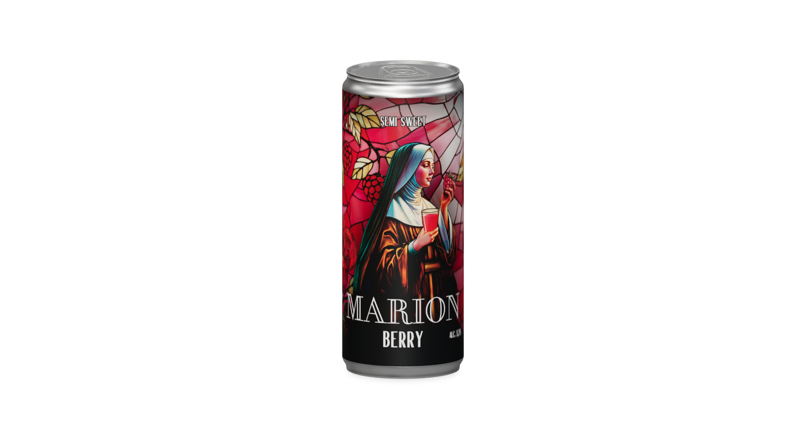](../src/assets/products/mead/marion-berry-330ml.png) Этикетка от 0,45 л                           | [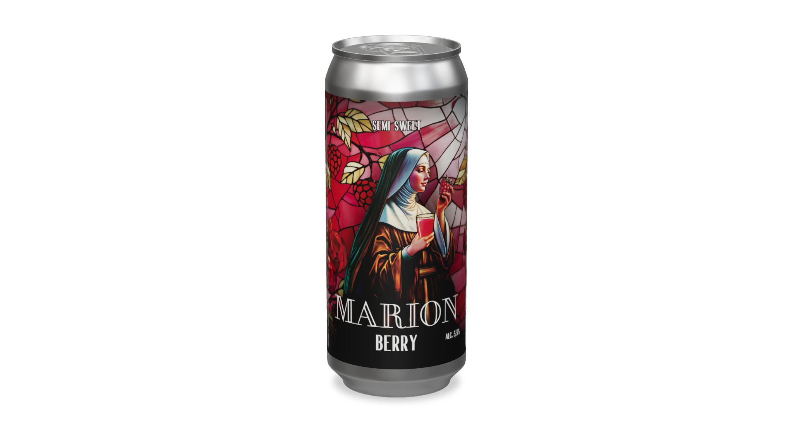](../src/assets/products/mead/marion-berry-450ml.png)                                                  | НЕТ ТАКОГО РАЗМЕРА | НЕТ ТАКОГО РАЗМЕРА | [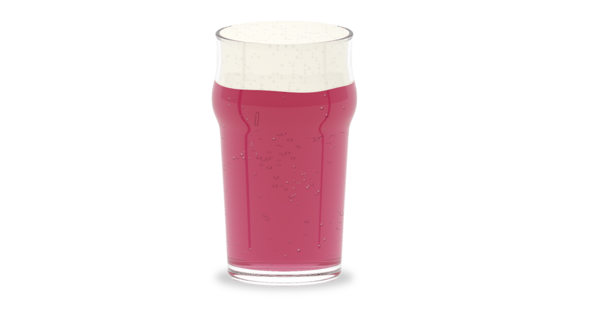](../src/assets/products/mead/marion-pomegranate-berry-glass.png) `mead-berry`; поглощение RGB `[0.35, 3.2, 1.8]`; рассеяние `1.5`; цвет рассеяния RGB `[0.42, 0.018, 0.065]`; пена да; пузырьки да |
|    ✅     | Медовуха «Мэрион» Манго              | [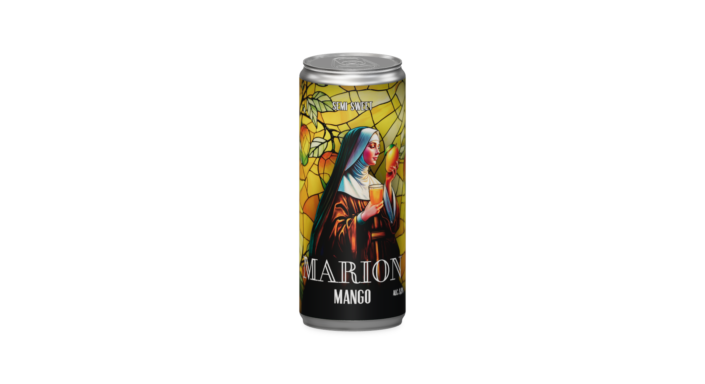](../src/assets/products/mead/marion-mango-330ml.png) Этикетка от 0,45 л                           | [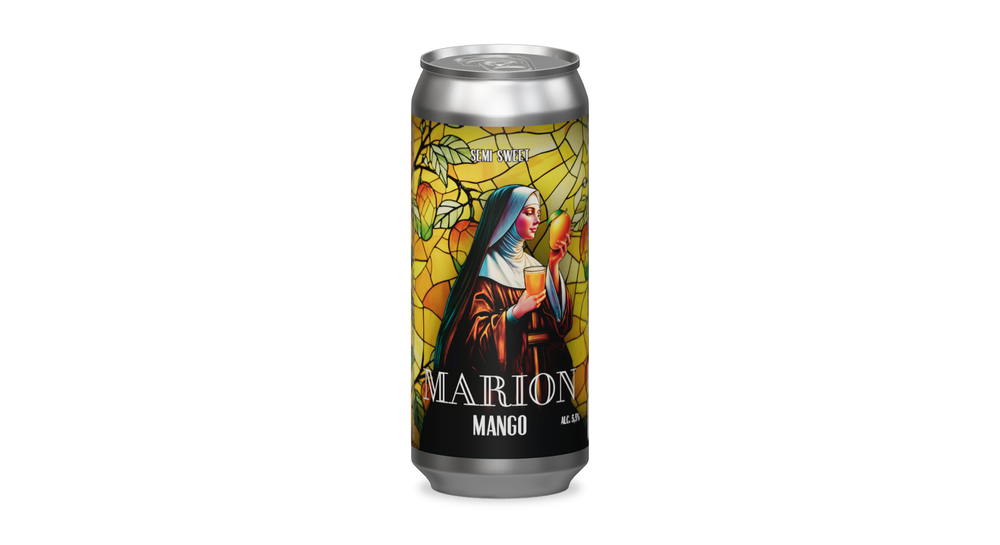](../src/assets/products/mead/marion-mango-450ml.png)                                                  | НЕТ ТАКОГО РАЗМЕРА | СДЕЛАТЬ            | [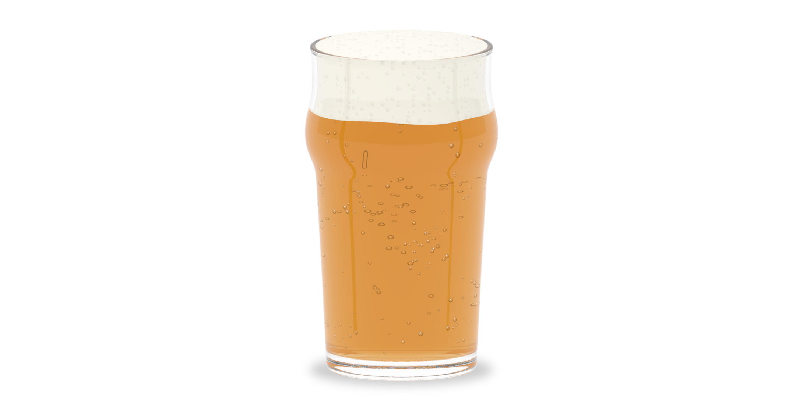](../src/assets/products/mead/marion-mango-glass.png) `mead-mango`; поглощение RGB `[0.1, 0.9, 3.4]`; рассеяние `2.4`; цвет рассеяния RGB `[0.7, 0.3, 0.02]`; пена да; пузырьки да |
|    ❌     | Медовуха «Мёдведь» Клюквенная        | НЕТ ТАКОГО РАЗМЕРА                                                                                                                                                                                                    | НЕТ ТАКОГО РАЗМЕРА                                                                                                                                                                                                     | НЕТ ТАКОГО РАЗМЕРА | СДЕЛАТЬ            | [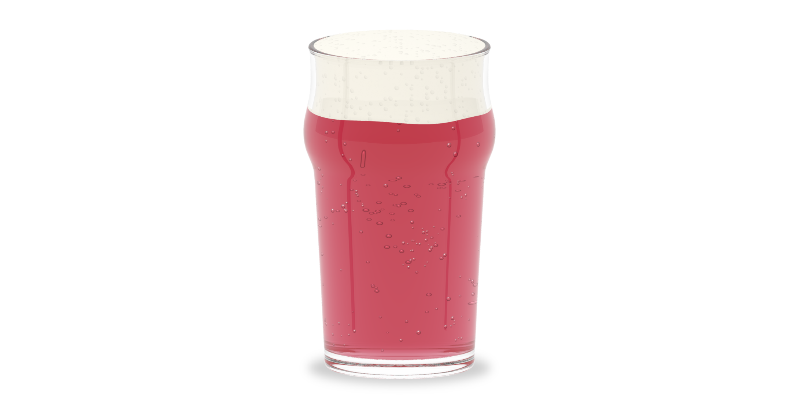](../src/assets/products/mead/medved-cranberry-glass.png) `mead-cranberry`; поглощение RGB `[0.3, 3, 2.1]`; рассеяние `1.2`; цвет рассеяния RGB `[0.48, 0.012, 0.02]`; пена да; пузырьки да |
|    ✅     | Медовуха «Мёдведь» с лесными ягодами | НЕТ ТАКОГО РАЗМЕРА                                                                                                                                                                                                    | НЕТ ТАКОГО РАЗМЕРА                                                                                                                                                                                                     | НЕТ ТАКОГО РАЗМЕРА | СДЕЛАТЬ            |  `mead-forest-berries`; поглощение RGB `[0.3, 3, 2.1]`; рассеяние `1.2`; цвет рассеяния RGB `[0.48, 0.012, 0.02]`; пена да; пузырьки да |
|    ✅     | Медовуха «Мёдведь» Облепиховая       | НЕТ ТАКОГО РАЗМЕРА                                                                                                                                                                                                    | НЕТ ТАКОГО РАЗМЕРА                                                                                                                                                                                                     | НЕТ ТАКОГО РАЗМЕРА | СДЕЛАТЬ            |  `mead-sea-buckthorn`; поглощение RGB `[0.08, 1.1, 3.8]`; рассеяние `2.5`; цвет рассеяния RGB `[0.8, 0.25, 0.015]`; пена да; пузырьки да |
|    ✅     | Медовуха «Мёдведь» Сливовая          | НЕТ ТАКОГО РАЗМЕРА                                                                                                                                                                                                    | НЕТ ТАКОГО РАЗМЕРА                                                                                                                                                                                                     | НЕТ ТАКОГО РАЗМЕРА | СДЕЛАТЬ            | [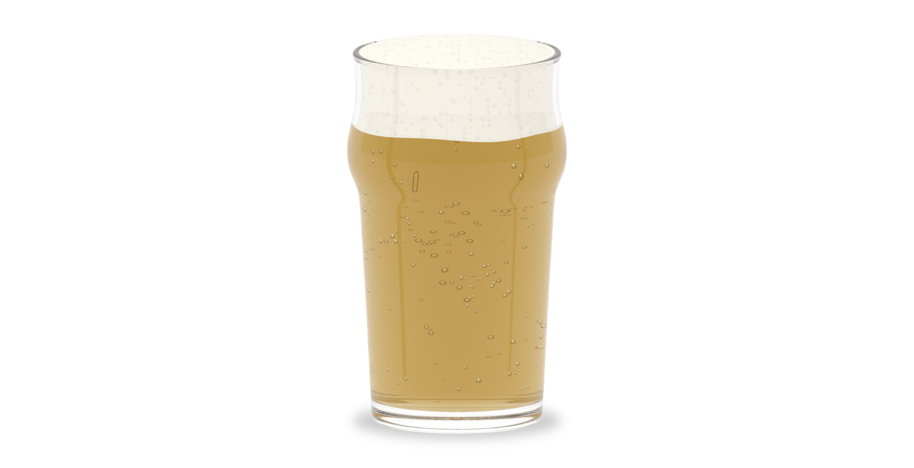](../src/assets/products/mead/medved-plum-glass.png) `mead-plum`; поглощение RGB `[0.28, 0.75, 2.4]`; рассеяние `1.6`; цвет рассеяния RGB `[0.46, 0.3, 0.05]`; пена да; пузырьки да |
|    ✅     | Медовуха «Мэрион» Черносмородиновая  | [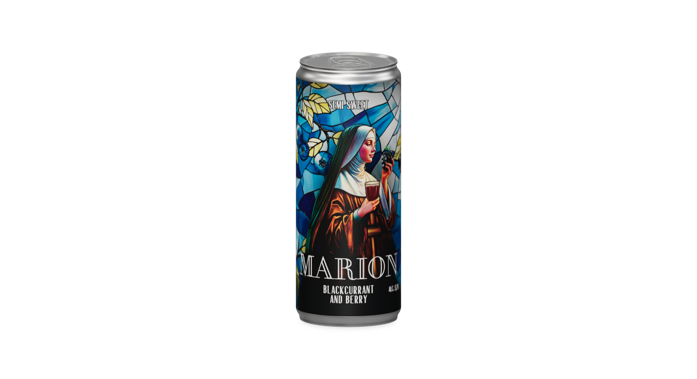](../src/assets/products/mead/marion-blackcurrant-330ml.png) Этикетка от 0,45 л | [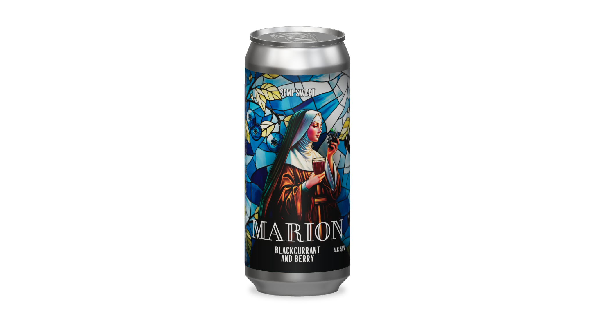](../src/assets/products/cider/marion-blackcurrant-berry-450ml.png)          | НЕТ ТАКОГО РАЗМЕРА | СДЕЛАТЬ            | [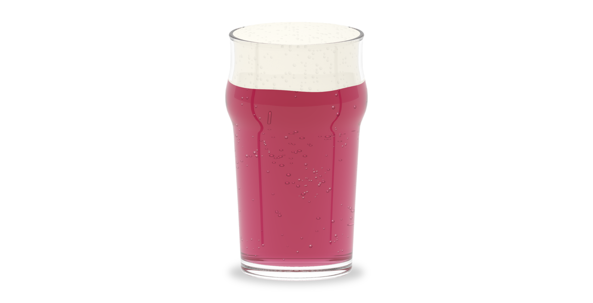](../src/assets/products/mead/medved-blackcurrant-glass.png) `mead-blackcurrant`; поглощение RGB `[0.55, 4.4, 2.6]`; рассеяние `0.6`; цвет рассеяния RGB `[0.22, 0.006, 0.036]`; пена да; пузырьки да |
|    ✅     | Медовуха «Мёдведь» Тёмная            | [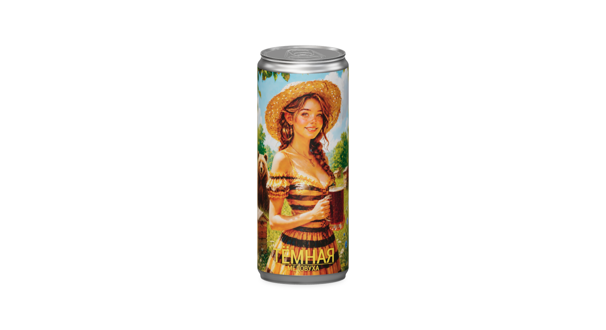](../src/assets/products/mead/medved-dark-330ml.png) Этикетка от 0,45 л                           | [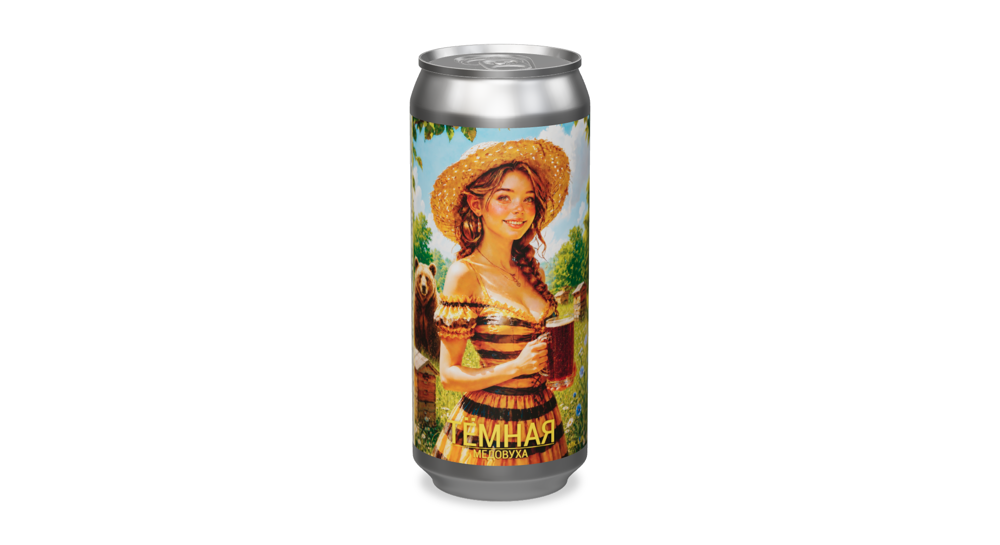](../src/assets/products/mead/medved-dark-450ml.png)                                                  | НЕТ ТАКОГО РАЗМЕРА | СДЕЛАТЬ            | [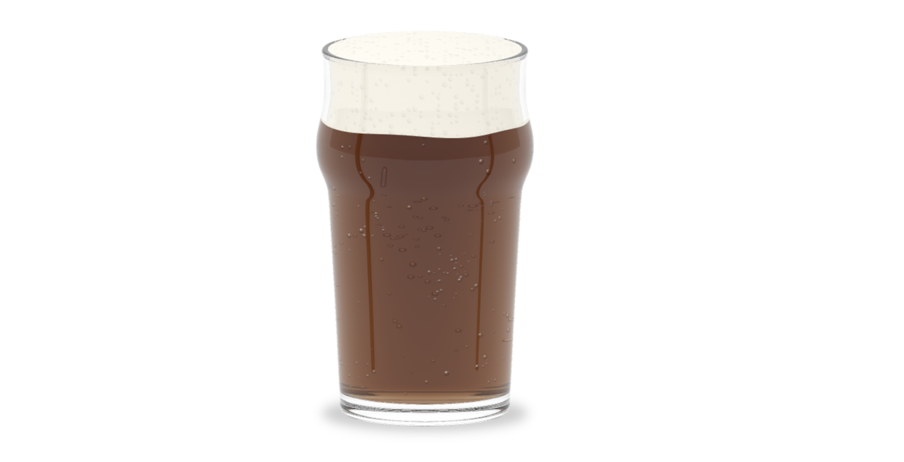](../src/assets/products/mead/medved-dark-glass.png) `mead-dark`; поглощение RGB `[2.5, 4.2, 6.5]`; рассеяние `0.2`; цвет рассеяния RGB `[0.07, 0.019, 0.005]`; пена да; пузырьки да |
|    ✅     | Медовуха «Мёдведь» Светлая           | [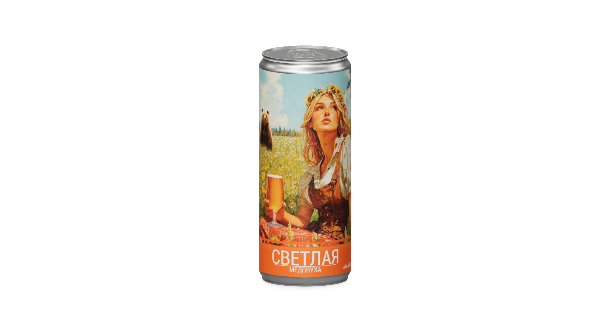](../src/assets/products/mead/medved-light-330ml.png) Этикетка от 0,45 л                        | [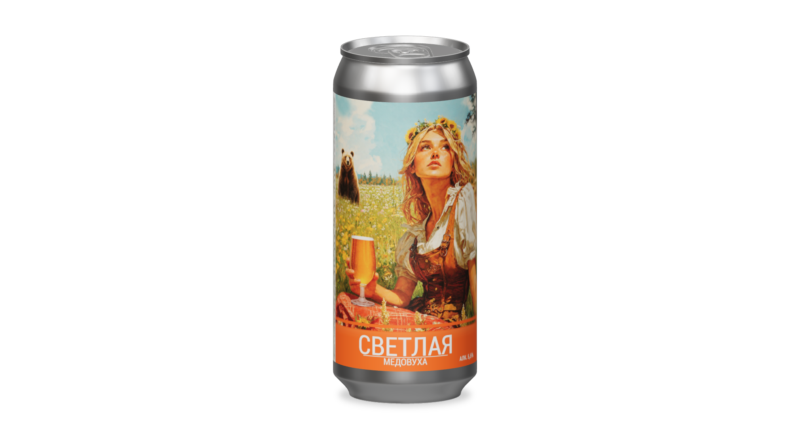](../src/assets/products/mead/medved-light-450ml.png)                                               | НЕТ ТАКОГО РАЗМЕРА | СДЕЛАТЬ            | [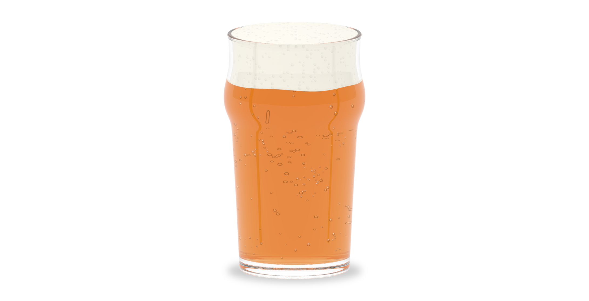](../src/assets/products/mead/medved-light-glass.png) `mead-light`; поглощение RGB `[0.08, 1.1, 3.8]`; рассеяние `2.5`; цвет рассеяния RGB `[0.8, 0.25, 0.015]`; пена да; пузырьки да |
|    ✅     | Медовуха «Мёдведь» Вишнёвая          | НЕТ ТАКОГО РАЗМЕРА                                                                                                                                                                                                    | НЕТ ТАКОГО РАЗМЕРА                                                                                                                                                                                                     | НЕТ ТАКОГО РАЗМЕРА | СДЕЛАТЬ            | [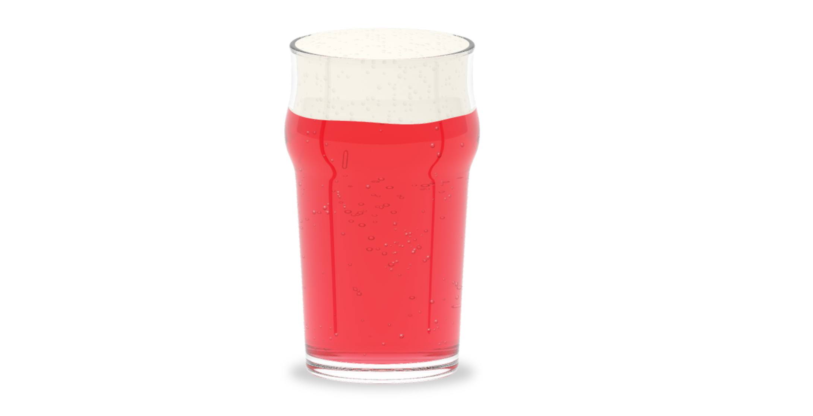](../src/assets/products/mead/medved-cherry-glass.png) `mead-cherry`; поглощение RGB `[0.12, 5.5, 4.5]`; рассеяние `0`; цвет рассеяния RGB `[0, 0, 0]`; пена да; пузырьки да |
|    ✅     | Сидр «Хмеляр»                        | [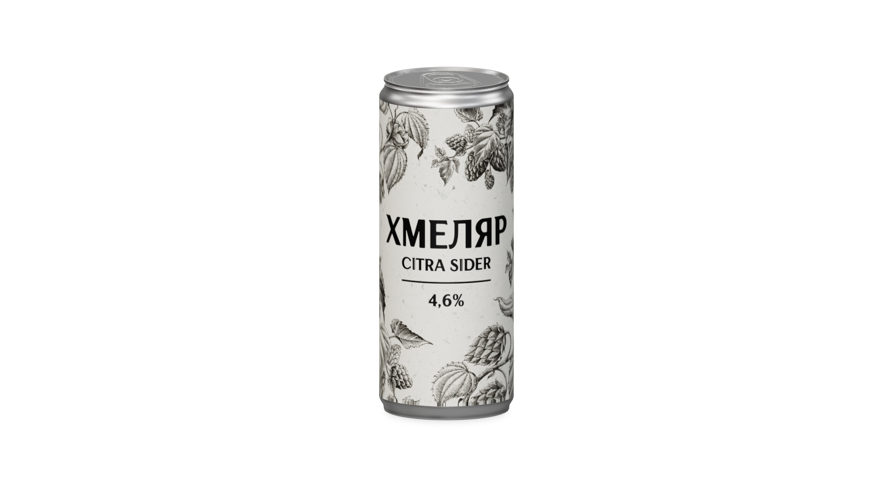](../src/assets/products/cider/khmelyar-330ml.png)                                                                 | [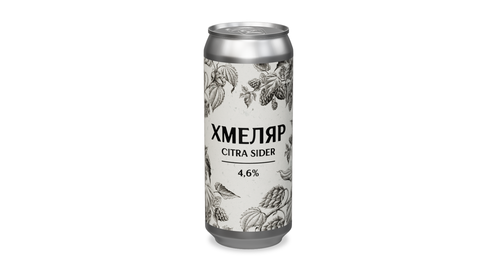](../src/assets/products/cider/khmelyar-450ml.png) Этикетка от 0,33 л                        | НЕТ ТАКОГО РАЗМЕРА | НЕТ ТАКОГО РАЗМЕРА | [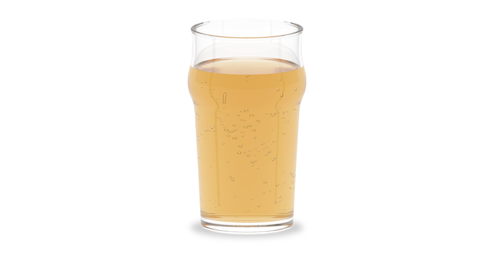](../src/assets/products/cider/khmelyar-glass.png) `cider-khmelyar`; поглощение RGB `[0.1, 0.7, 2.5]`; рассеяние `0.6`; цвет рассеяния RGB `[0.62, 0.36, 0.09]`; пена нет; пузырьки да |
|    ✅     | Сидр «Вудсток»                       | [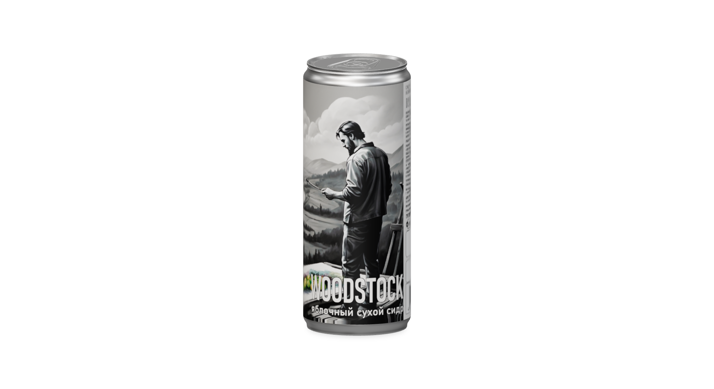](../src/assets/products/cider/woodstock-330ml.png)                                                              | [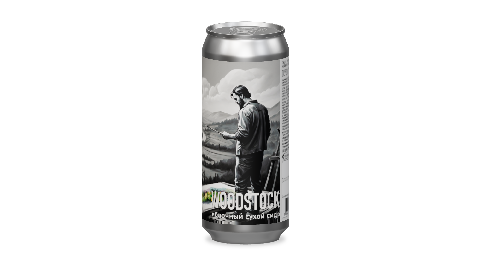](../src/assets/products/cider/woodstock-450ml.png) Этикетка от 0,33 л                     | НЕТ ТАКОГО РАЗМЕРА | НЕТ ТАКОГО РАЗМЕРА | [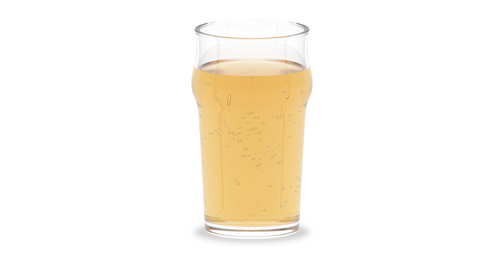](../src/assets/products/cider/woodstock-glass.png) `cider-woodstock`; поглощение RGB `[0.08, 0.62, 2.3]`; рассеяние `0.35`; цвет рассеяния RGB `[0.7, 0.45, 0.16]`; пена нет; пузырьки да |
|    ✅     | Сидр «Валентайн»                     | [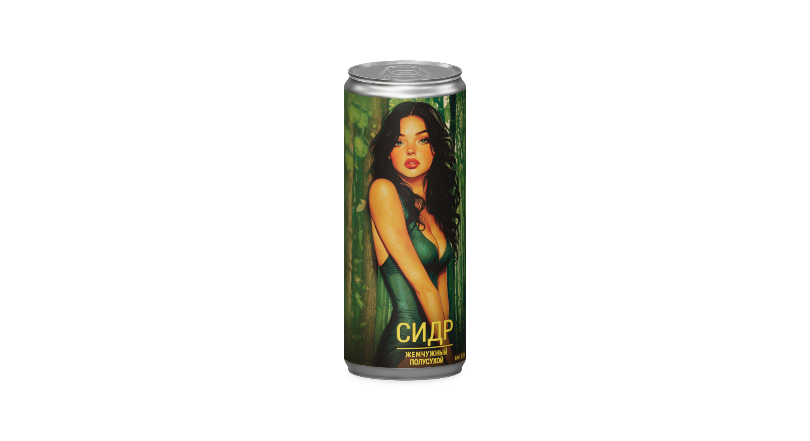](../src/assets/products/cider/valentine-330ml.png) Этикетка от 0,45 л                                      | [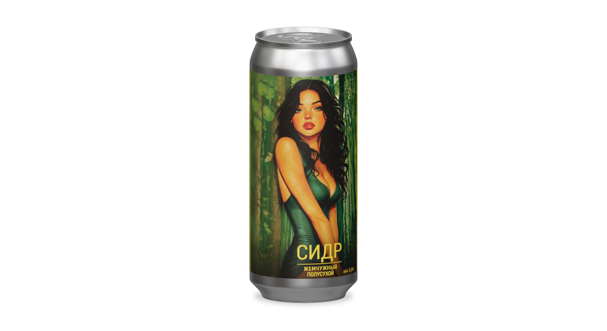](../src/assets/products/cider/valentine-450ml.png)                                                             | НЕТ ТАКОГО РАЗМЕРА | НЕТ ТАКОГО РАЗМЕРА |  `cider-valentine`; поглощение RGB `[0.03, 0.3, 2]`; рассеяние `0`; цвет рассеяния RGB `[0, 0, 0]`; пена нет; пузырьки да |
|    ✅     | Сидр Вишневый                        | [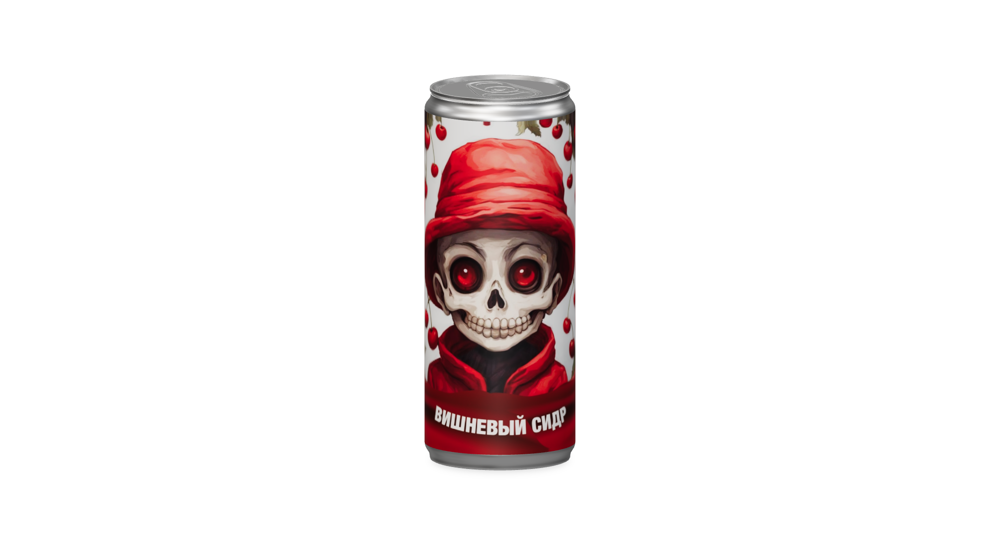](../src/assets/products/cider/cherry-330ml.png)                                                                     | [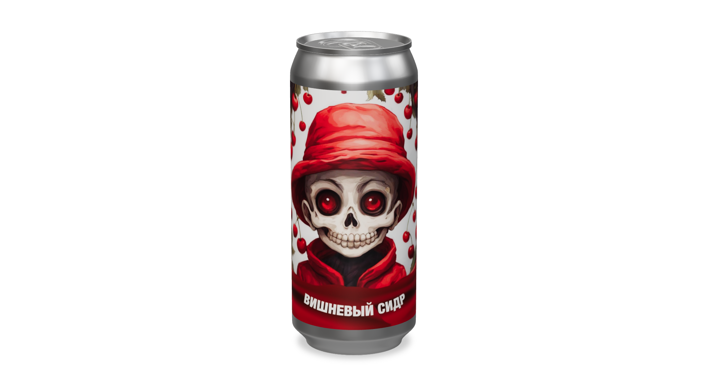](../src/assets/products/cider/cherry-450ml.png) Этикетка от 0,33 л                            | СДЕЛАТЬ            | НЕТ ТАКОГО РАЗМЕРА | [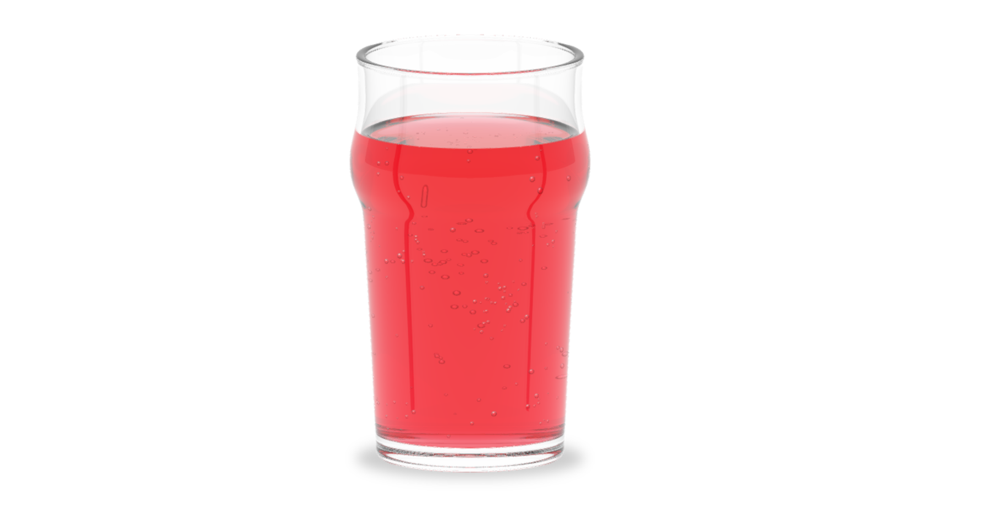](../src/assets/products/cider/cherry-glass.png) `cider-cherry`; поглощение RGB `[0.12, 5.5, 4.5]`; рассеяние `0`; цвет рассеяния RGB `[0, 0, 0]`; пена нет; пузырьки да |
|    ✅     | Сидр «Антоновка»                     | [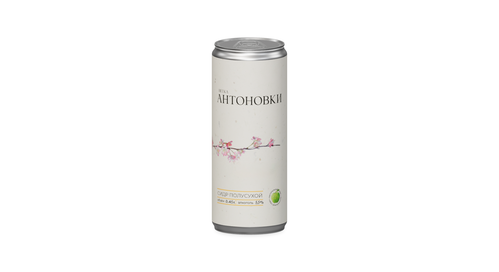](../src/assets/products/cider/antonovka-330ml.png) Этикетка от 0,45 л                                      | [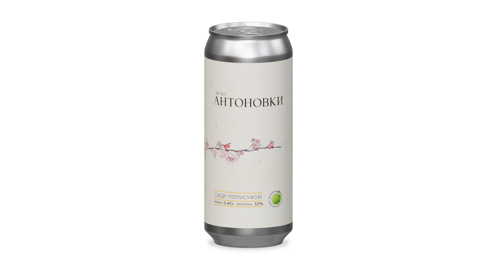](../src/assets/products/cider/antonovka-450ml.png)                                                             | СДЕЛАТЬ            | НЕТ ТАКОГО РАЗМЕРА | [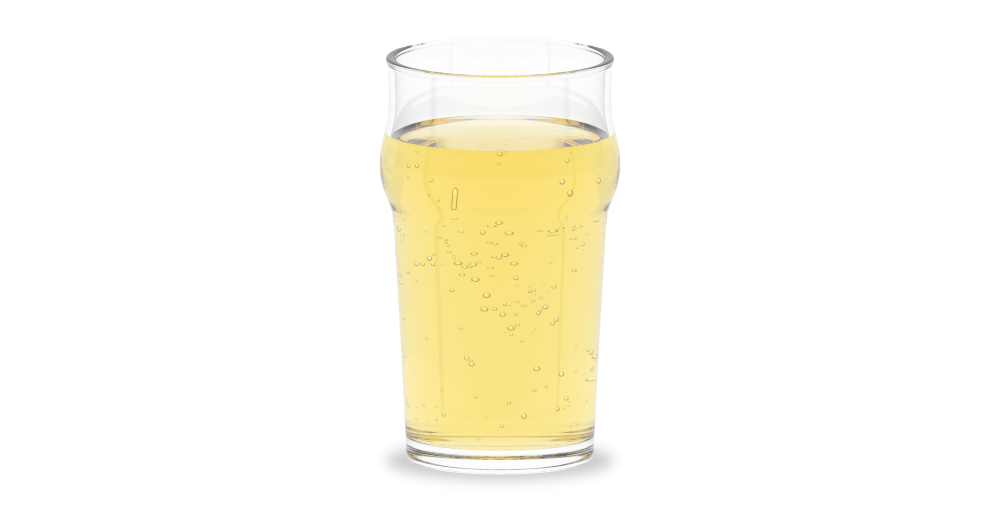](../src/assets/products/cider/antonovka-glass.png) `cider-antonovka`; поглощение RGB `[0.03, 0.3, 2]`; рассеяние `0`; цвет рассеяния RGB `[0, 0, 0]`; пена нет; пузырьки да |
|    ✅     | Пуаре «Мистер Вильямс»               | [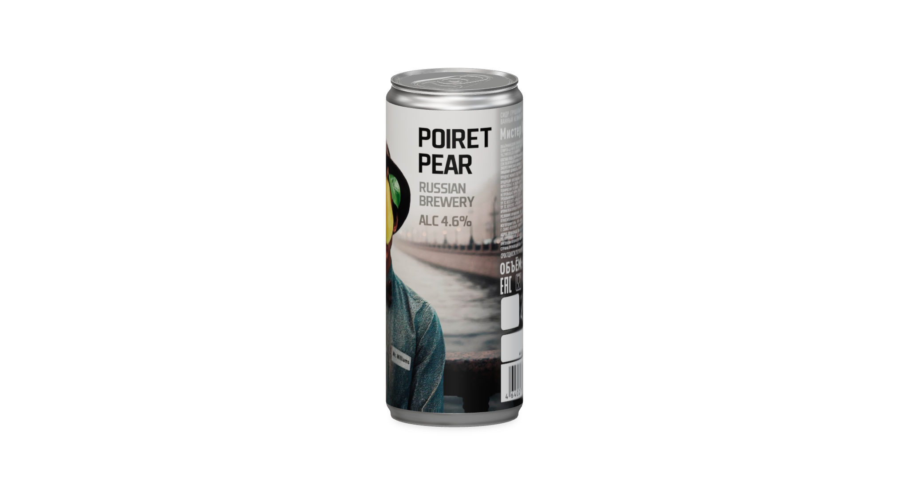](../src/assets/products/perry/mister-williams-330ml.png)                                          | [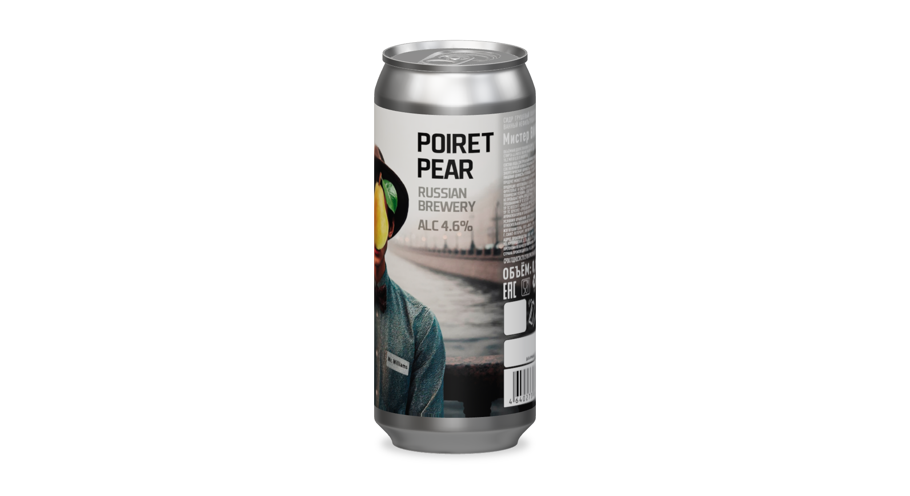](../src/assets/products/perry/mister-williams-450ml.png) Этикетка от 0,33 л | СДЕЛАТЬ            | СДЕЛАТЬ            | [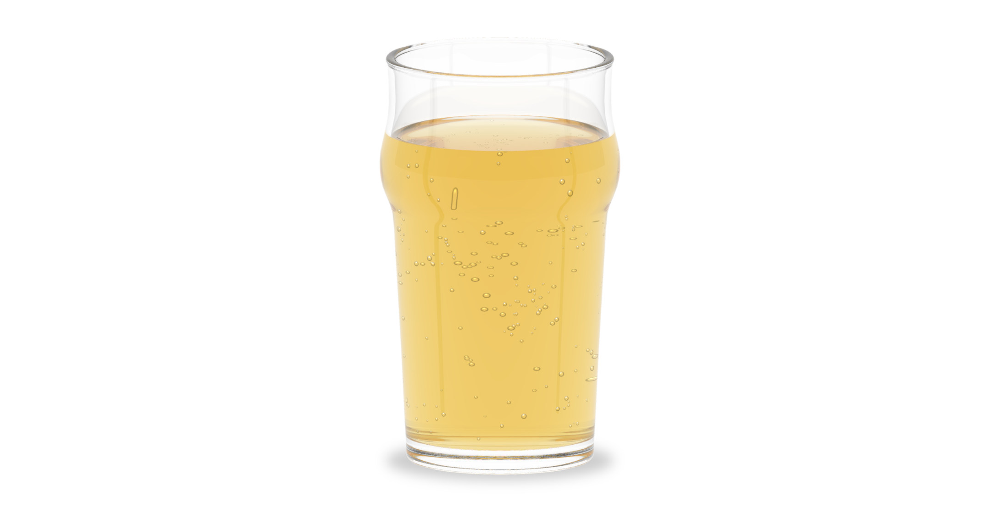](../src/assets/products/perry/mister-williams-glass.png) `perry-williams`; поглощение RGB `[0.05, 0.5, 2.6]`; рассеяние `0.5`; цвет рассеяния RGB `[0.7, 0.5, 0.12]`; пена нет; пузырьки да |

