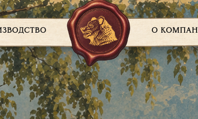
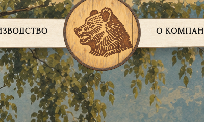
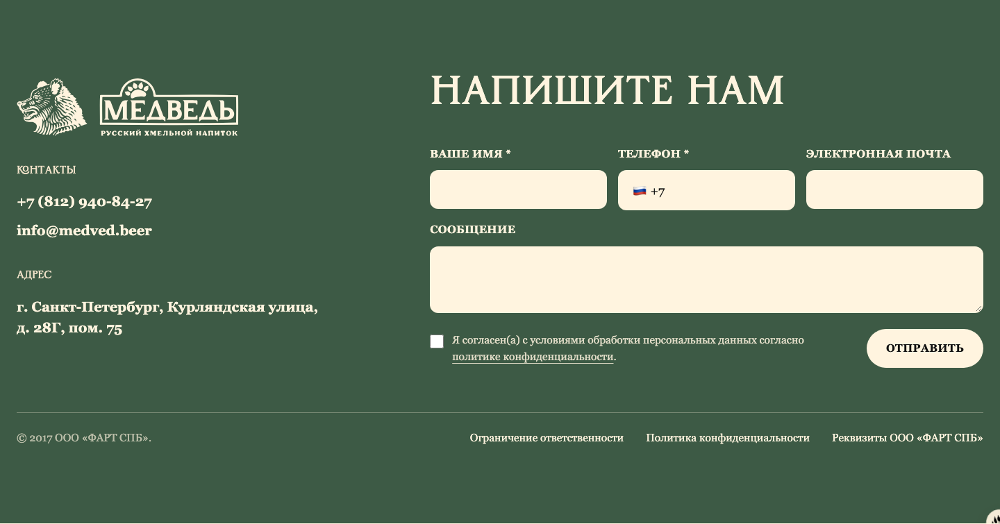
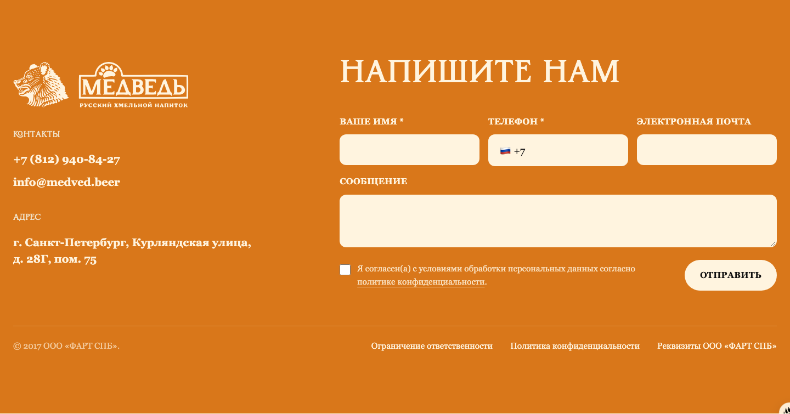
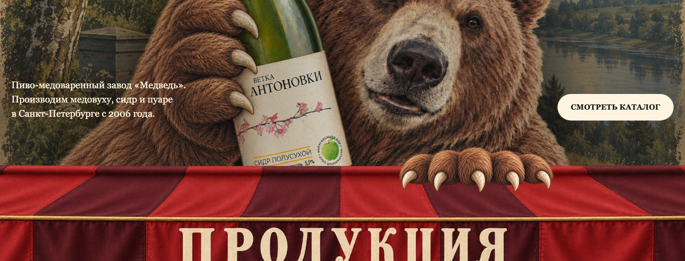
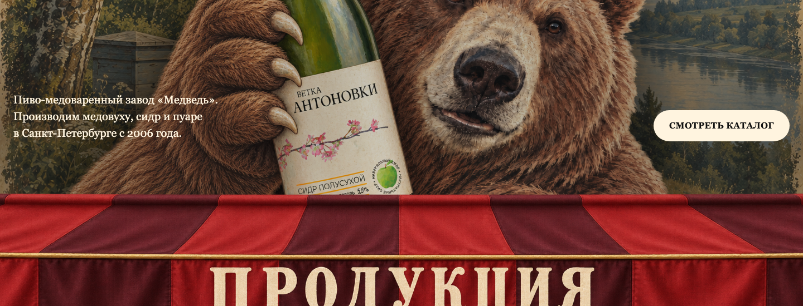
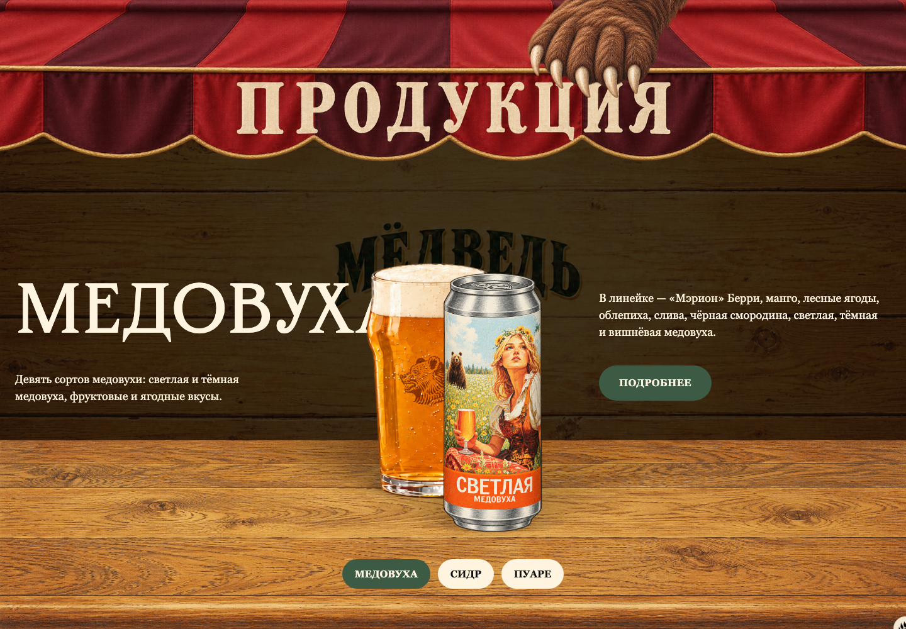
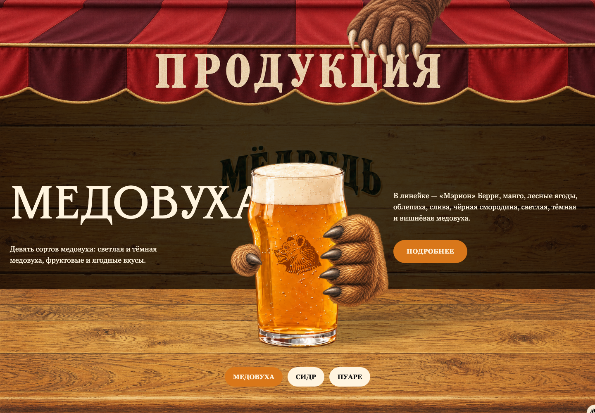

# Отличия оригинальной и клиентской версий

| Название механики | Оригинал | Клиентская |
|---|---|---|
| Логотип в шапке | Медведь на сургучной печати  | Медведь с выжиганием на крышке бочки  |
| Акцентный цвет сайта | Зелёный `#3d5a45`  | Рыжий `#d9771a`  |
| Слоган на главной | «Варим с душой»  | «Пчелы умрут от зависти»  |
| Лапа на козырьке под главным hero | Из-за верхнего края козырька выглядывают пальцы медведя с когтями  | Лапы на козырьке нет  |
| Продукция в слайдере на главной | Банка и бокал; банка начинает движение первой, бокал — с задержкой 100 мс  | Бокал без банки; собственный уменьшенный масштаб, положение и тень. Лапа разгоняет бокал и отпускает его; встречная зеркальная лапа ловит его, отклоняется вместе с ним и плавно возвращается в покой. Большой палец отогнут при отпускании и согнут при захвате. Маска скрывает предплечье и уход кисти за стойку, сохраняя передние пальцы целыми в покое.  |
